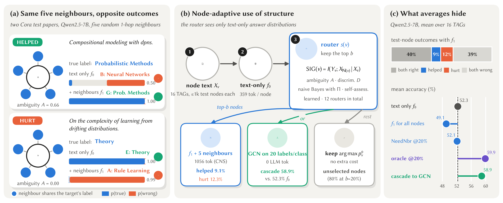
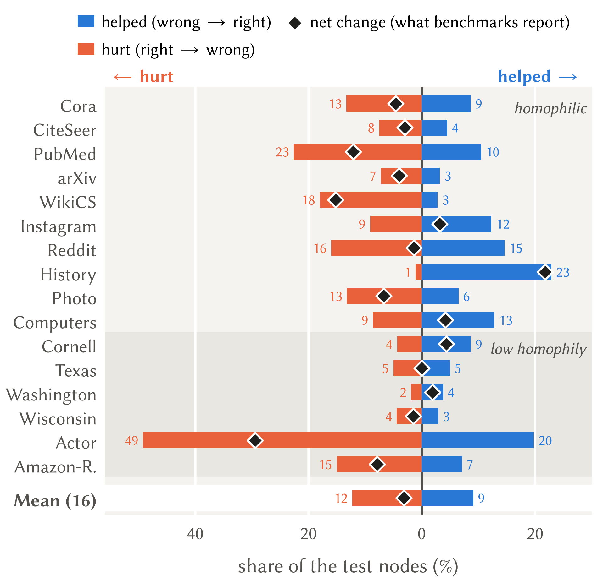
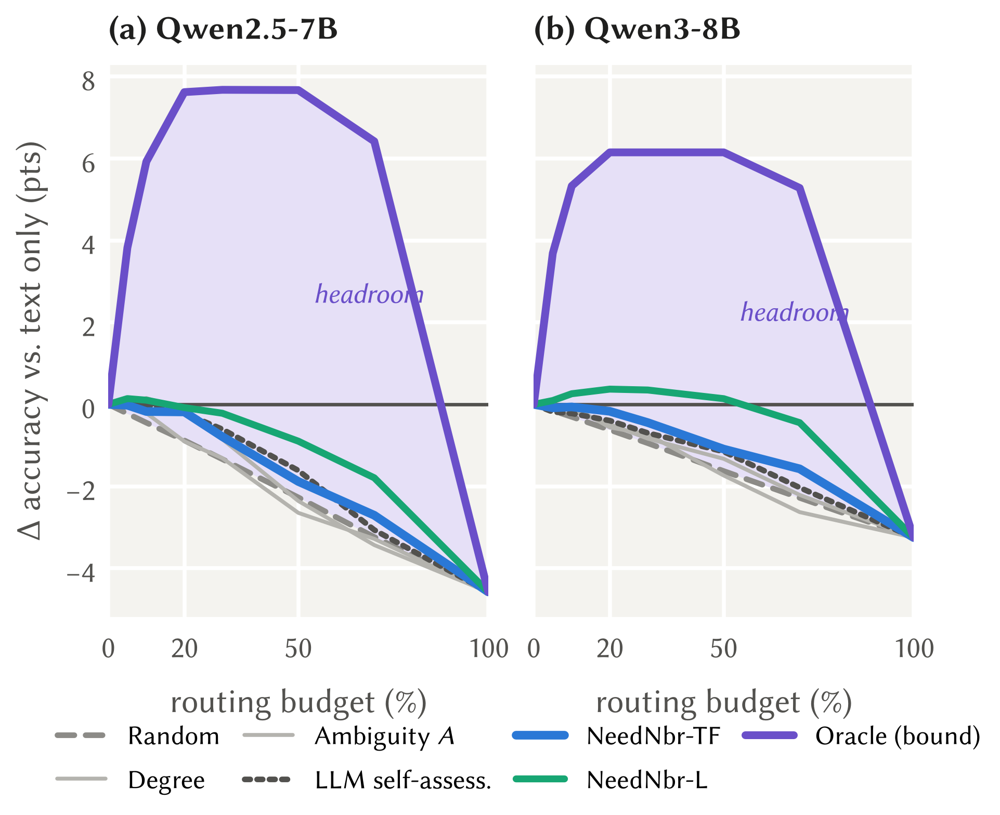
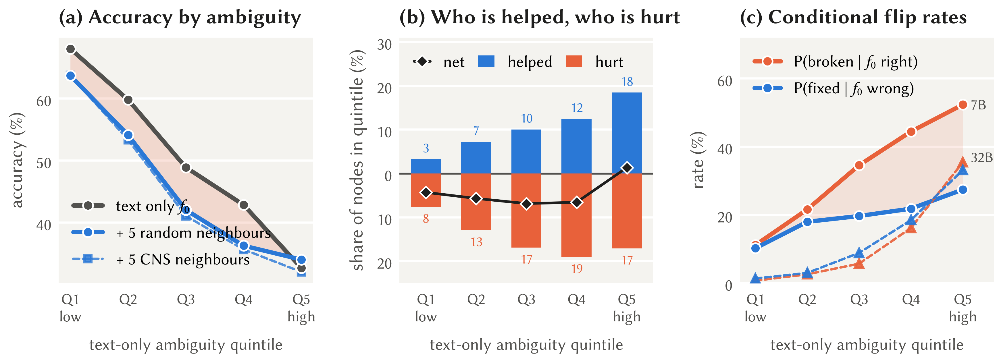
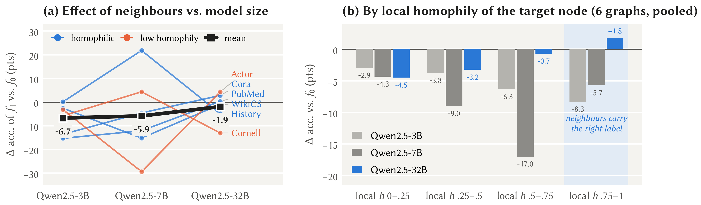
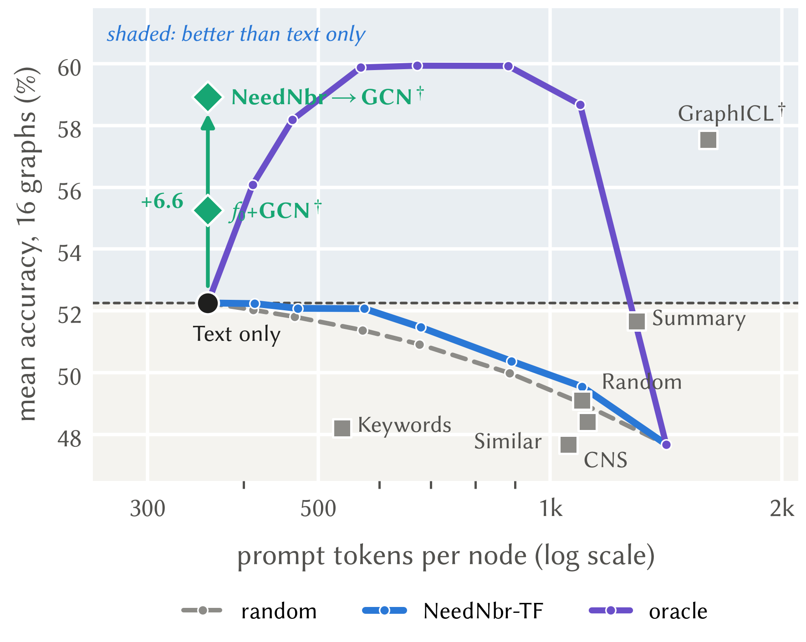
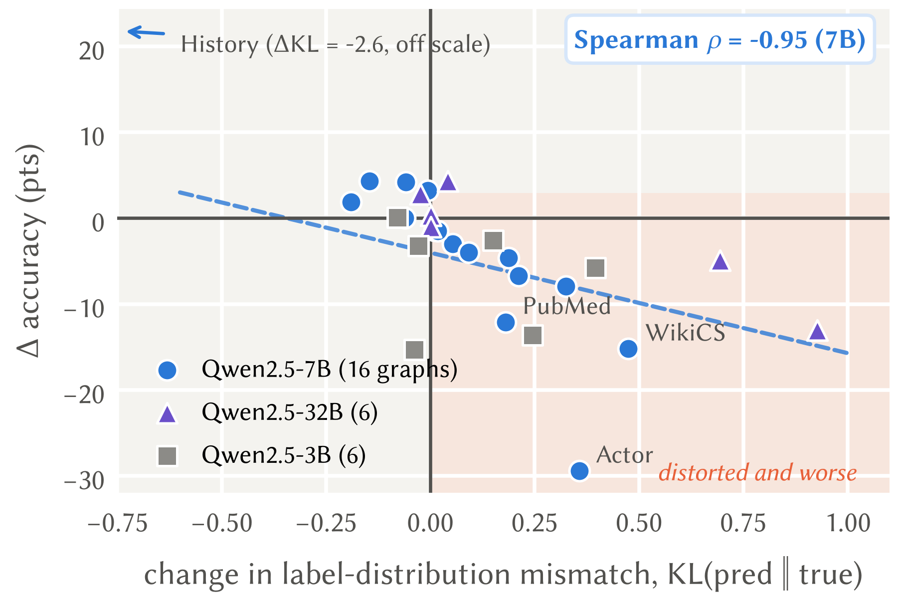

<h1 align="center">Volatile, Not Useless</h1>

<h3 align="center">When Should an LLM Look at the Neighbours of a Node in a Text-Attributed Graph?</h3>

<p align="center">


</p>

<p align="center">

</p>

---

## TL;DR

Benchmarks report that pasting a node's neighbours into an LLM prompt helps little on text-attributed graphs (TAGs).
We look at the same experiment **per node** and find that structure is *volatile* rather than useless:

| | Qwen2.5-7B, mean over 16 TAGs |
|---|---|
| Test nodes turned **wrong → right** by 5 random neighbours | **9.1 %** |
| Test nodes turned **right → wrong** by the same neighbours | **12.3 %** |
| Text-only accuracy | 52.3 % |
| Oracle that sends the best 20 % of nodes to the graph-augmented prompt | **59.9 %** (+7.6 pts) |
| Best realisable router (learned, AUC over budgets) | 50.9 vs. 50.0 for random routing |
| Cascade: routed nodes answered by a GCN instead of a longer prompt | **58.9 %** at text-only token cost |

* **Ambiguity measures volatility.** Ambiguous nodes are the most likely to be fixed *and* the most likely to be
  broken, so every pre-call signal we tried (entropy, calibration, LLM self-assessment, our SIG estimators, a learned
  router) stays within 1.2 AUC points of random routing.
* **The reader matters more than the graph.** The mean effect of five random neighbours is −6.7 / −5.9 / −1.9 points
  for Qwen2.5-3B / 7B / 32B; at 7B neighbours hurt even nodes whose neighbours nearly all share their label, and losses
  track a distorted predicted-label distribution (Spearman ρ = −0.95 over 16 graphs).
* **Structure pays off outside the prompt.** A GCN trained on the same 20 labels per class reaches 65.5 %, and an
  LLM→GCN cascade adds +6.6 points over text-only inference without a single extra LLM token.

---

## Contents

- [What is in this repository](#what-is-in-this-repository)
- [Method in one page](#method-in-one-page)
- [Installation](#installation)
- [Running the experiments](#running-the-experiments)
- [Outputs](#outputs)
- [Results](#results)
- [Reproducing the paper figures](#reproducing-the-paper-figures)
- [Notes and scope](#notes-and-scope)
- [Citation](#citation)
- [Acknowledgements](#acknowledgements)

---

## What is in this repository

```
.
├── run_all.py               # one command for all 150 jobs (download → prep → GNNs → LLM jobs → analysis → summary)
├── requirements.txt
├── configs/default.yaml     # models, splits, prompt lengths, budgets, dataset metadata, experiment lists
├── needn/                   # the library (NeedNbr = "need neighbours")
│   ├── download.py          # LLMNodeBed + HeTGB downloader (resumable, honours HF_ENDPOINT)
│   ├── data.py              # unified loading, 20-per-class split, 1-hop-then-2-hop candidate pools
│   ├── prepare.py           # processed graph + bge-base-en-v1.5 embeddings
│   ├── prompts.py           # f0 / f1 / self-assessment / summary / GraphICL-style prompts
│   ├── llm.py               # vLLM or HF backend, first-token option scoring (top-80 log-probs), sqlite cache
│   ├── sig.py               # SIG estimators (A, D, NB), compatibility matrix Π, CNS neighbour selection
│   ├── run_llm.py           # main job per (LLM, dataset): f0, Π, SIG features, 9 neighbour contexts
│   ├── analyze.py           # offline analysis: budget curves, AUC, Spearman, learned/auto routers, McNemar, ...
│   ├── gnn.py               # MLP, GCN, GraphSAGE, GAT, GPR-GNN, H2GCN-lite, label propagation
│   ├── distill.py           # LLM pseudo-labels → GCN (no ground-truth labels for training or model selection)
│   ├── aggregate.py         # results/summary.md, 48 LaTeX tables, overview plots
│   ├── experiments.py       # the job graph
│   └── scheduler.py, runtime.py, utils.py
├── paper/
│   ├── make_figures.py      # every figure, table and in-text number of the paper
│   └── figures/icons/       # icons used in Figure 1 (icons8.com)
├── results/                 # the outputs of our run (see "Outputs"); raw per-prompt files are not included
└── assets/                  # figures shown in this README
```

Not included because of their size: `data/` (raw graphs, processed graphs and embeddings, about 4 GB; recreated by
`run_all.py`), `results/llm/**/raw.pkl` (per-node LLM outputs, 117 MB), the GCN probability files
`results/gnn/probs_*.npy`, the LLM caches and the job logs.

---

## Method in one page

Every node gets a cheap **text-only** prompt $f_0$; a **graph-augmented** prompt $f_1$ adds the texts of $k=5$
neighbours. The per-node gain is $g(v)=\mathbb 1[f_1\ \text{correct}]-\mathbb 1[f_0\ \text{correct}]$, and a
**router** decides, under a budget $b$, which nodes receive $f_1$. All scores below are computed from text-only
answer distributions $p^0$, without an extra LLM call for the target.

| Quantity | Definition | Code |
|---|---|---|
| Structural information gain | $\mathrm{SIG}(v)=I(Y_v;X_{\mathcal N(v)}\mid X_v)\le H(Y_v\mid X_v)$ | — |
| Ambiguity | $A(v)=H(p^0_v)/\log C$ | `sig.sig_features` |
| Compatibility | $\Pi_{ab}=P(Y_v=a\mid Y_u=b)$ from edges, one-hot training labels, add-0.1 smoothing, symmetrised | `sig.estimate_compat` |
| Neighbour message | $m_u=\Pi p^0_u$ (2-hop candidates: $\Pi^2p^0_u$) | `sig.message` |
| Discriminativeness | $D(v)=\frac1{\lvert\mathcal N(v)\rvert}\sum_u\big(1-\tfrac{H(m_u)}{\log C}\big)\,m_u(\mathrm{Top}_3(p^0_v))$ | `sig.sig_features` |
| Naive-Bayes gain (NeedNbr-TF) | $\mathrm{NB}(v)=H(p^0_v)-H(q_v)$, $q_v\propto p^0_v\odot\prod_u m_u^{0.5}$ | `sig.nb_posterior` |
| NeedNbr-L | gradient boosting on $A$, $D$, NB, NB with $\Pi=I$, degree, $\max p^0$, log text length, fitted on validation nodes | `analyze.learned_router` |
| NeedNbr-auto | NB threshold that maximises validation accuracy (no budget needed) | `analyze.auto_threshold` |
| CNS | greedy: entropy drop of the NB posterior − 0.5·max(0, max cos to chosen − 0.5) + 1e-3·cos to target | `sig.select_cns` |

Option distributions are read from the first generated token: the top-80 log-probabilities, summing the spellings
`X` and ` X`, options A–Z then a–z (only arXiv, with 40 classes, uses lower-case letters). In our run none of the
783,305 scored prompts was truncated and none lacked an option letter in the top 80.

---

## Installation

```bash
git clone <this repository> && cd <repository>
pip install -r requirements.txt
```

`requirements.txt` lists `vllm>=0.8.5` and `transformers>=4.51` (both needed for Qwen3), `torch`,
`torch_geometric`, `sentence-transformers>=3.0`, `scikit-learn`, `scipy`, `numpy`, `pyyaml`, `matplotlib`,
`sentencepiece` and `protobuf`. `run_all.py` also installs missing packages itself (it never upgrades `torch`).

Our run used Python 3.12.15 and PyTorch 2.13.0 (CUDA 13.0) with vLLM. Without vLLM, set `LLM_BACKEND=hf` to use the
Hugging Face `transformers` backend (much slower; meant for small local checks).

---

## Running the experiments

**Everything, one command.** Downloads the data, builds the 150-job graph and runs it with a dependency-aware GPU
scheduler; finished jobs are skipped on restart and LLM calls are cached per (LLM, dataset), so an interrupted run
resumes where it stopped.

```bash
CUDA_VISIBLE_DEVICES=0 nohup python run_all.py > run.log 2>&1 &
```

| Option | Effect |
|---|---|
| `--quick` | first LLM and first three datasets only (Cora, CiteSeer, PubMed); a smoke test |
| `--config path.yaml` | use another configuration |
| `--skip_download` | do not try to download the data |
| `HF_ENDPOINT=https://hf-mirror.com` | download models and data through a mirror |
| `HF_TOKEN=...` | adds `meta-llama/Llama-3.1-8B-Instruct` if your token has access; otherwise it is skipped |

The reported results come from a run on **one 48 GB GPU**. Jobs for Qwen2.5-32B-Instruct-AWQ ask for two GPUs
(tensor parallelism 2); with one visible GPU the scheduler and `runtime.build_vllm` fall back to tensor parallelism 1,
and every engine configuration actually used is logged in `results/engine_log.jsonl`. All 150 jobs completed; the
final `run_all.py` invocation, with data preparation and GNN jobs already done by an earlier invocation, took 12.2 h.
Llama-3.1-8B was skipped (no access to the gated model).

**Single stages.** Every job is a module with `--dataset` (and `--llm` where relevant):

```bash
python -m needn.prepare  --dataset cora                                        # graph + embeddings
python -m needn.gnn      --dataset cora                                        # 7 graph baselines, 5 seeds
python -m needn.gnn      --dataset cora --probs                                # GCN class probabilities
python -m needn.run_llm  --dataset cora --llm Qwen/Qwen2.5-7B-Instruct --graphicl
python -m needn.run_llm  --dataset cora --llm Qwen/Qwen2.5-7B-Instruct --k 3   # k-sensitivity (reuses f0)
python -m needn.analyze  --dataset cora --llm Qwen/Qwen2.5-7B-Instruct          # no LLM calls
python -m needn.distill  --dataset arxiv --llm Qwen/Qwen2.5-7B-Instruct         # needs run_llm --annotate 2000
python -m needn.aggregate                                                      # summary.md + LaTeX tables
```

**Data.** `needn/download.py` fetches the 14 LLMNodeBed graphs (`xxwu/LLMNodeBed` on the Hugging Face Hub: Cora,
CiteSeer, PubMed, arXiv, WikiCS, Instagram, Reddit, History, Photo, Computers and the four WebKB graphs) and the
HeTGB Actor and Amazon-ratings graphs (`jinxi0219/HeTGB`). Splits use seed 2026: 20 training labels per class, 15 % of
the remaining nodes (at most 500) for validation, of which up to 300 fit the learned components, and a fixed random
subset of 1,000 test nodes for the LLMs (all test nodes on the WebKB graphs: 69, 80, 106, 136).

---

## Outputs

| Path | Content | Included here |
|---|---|---|
| `results/summary.md` | every table of the study in Markdown | yes |
| `results/latex/*.tex` | the same 48 tables in booktabs LaTeX | yes |
| `results/analysis/<llm>/<dataset>.json` | full analysis per (LLM, dataset): accuracies, budget curves for every router × context, Spearman, McNemar/bootstrap, helped/hurt breakdown, local-homophily strata, case studies | yes |
| `results/analysis/<llm>/ksens_<dataset>.json` | k ∈ {3, 5, 10} sensitivity | yes |
| `results/gnn/<dataset>.json` | graph baselines (mean ± std over 5 seeds) | yes |
| `results/distill/<llm>/<dataset>.json` | distillation of LLM pseudo-labels into a GCN | yes |
| `results/engine_log.jsonl` | every vLLM engine start (tensor parallelism, context length, fallbacks) | yes |
| `results/llm/<llm>/<dataset>/raw.pkl` | per-node option distributions, selected neighbours, token counts | no (117 MB) |

In the shipped files, absolute server paths were shortened to repository-relative paths, and e-mail addresses that
appear in dataset texts quoted by the case studies were replaced with `[email removed]`; no number was changed.
The analysis JSONs contain everything the paper tables need. `python -m needn.aggregate` rebuilds `summary.md` and
the LaTeX tables from them; only the k-sensitivity table additionally needs the `raw_k*.pkl` files.

---

## Results

All numbers are means over test nodes and graphs, read from the files in `results/`.

**Accuracy (%) with neighbour context for every node** (16 graphs). NeedNbr and Oracle send only 20 % of the nodes
to $f_1$ with CNS neighbours; † uses the 20 labels per class.

| LLM | Text only | Random | Similar | CNS | Keywords | Summary | GraphICL† | NeedNbr@20% | Oracle@20% |
|---|---|---|---|---|---|---|---|---|---|
| Qwen2.5-7B | 52.3 | 49.1 | 48.4 | 47.7 | 48.2 | 51.7 | **57.5** | 52.1 | *59.9* |
| Qwen3-8B | 49.7 | 46.7 | 46.4 | 46.5 | 47.1 | 50.3 | – | 49.6 | *55.9* |

<p align="center"> &nbsp; </p>

**Routing quality** (CNS neighbours; AUC = mean accuracy over budgets 0–100 %; W/L = graphs on which the router beats
/ loses to random routing at a 20 % budget).

| Router | 7B AUC | 7B Spearman ρ | 7B W/L | Qwen3-8B AUC | 32B AUC (6 graphs) |
|---|---|---|---|---|---|
| Random | 50.0 | – | – | 48.1 | 65.7 |
| Ambiguity $A$ | 50.1 | −0.01 | 10/6 | 48.3 | 65.5 |
| $A$, calibrated | 50.3 | +0.02 | 11/5 | 48.4 | 66.7 |
| LLM self-assessment | 50.4 | +0.03 | 10/6 | 48.4 | 65.3 |
| NeedNbr-TF (NB) | 50.4 | +0.05 | 8/8 | 48.6 | 64.8 |
| NeedNbr-L (learned) | 50.9 | +0.08 | 12/4 | 49.3 | 66.5 |
| *Oracle* | *57.3* | – | – | *53.9* | *70.1* |

<p align="center"></p>

**Model scale** (Qwen2.5 family, six shared graphs, accuracy %).

| Model | graphs with $f_1<f_0$ | Text only | Random | Similar | CNS | NeedNbr@20% | Oracle@20% |
|---|---|---|---|---|---|---|---|
| Qwen2.5-3B | 5/6 | 32.8 | 26.0 | 27.1 | 24.3 | 32.6 | *38.5* |
| Qwen2.5-7B | 4/6 | 56.3 | 50.4 | 48.2 | 47.7 | 56.4 | *66.9* |
| Qwen2.5-32B (AWQ) | 3/6 | 66.8 | 64.9 | 64.7 | 64.6 | 65.4 | *71.3* |

<p align="center"></p>

**Using the labels outside the prompt** (frozen `bge-base` embeddings, 20 labels per class, 5 seeds; LLM rows use
Qwen2.5-7B).

| Method | Homophilic (10) | Low homophily (6) | All (16) | LLM tokens / node |
|---|---|---|---|---|
| MLP | 64.0 | 68.9 | 65.8 | 0 |
| GCN | 71.3 | 55.8 | 65.5 | 0 |
| GraphSAGE | 71.3 | 67.6 | **69.9** | 0 |
| GPR-GNN | 72.4 | 61.8 | 68.4 | 0 |
| LLM text only | 49.9 | 56.2 | 52.3 | 359 |
| LLM GraphICL-style | 56.6 | 59.1 | 57.5 | 1603 |
| LLM text only + GCN (probability average) | 54.0 | 57.4 | 55.3 | 359 |
| NeedNbr-TF@20% → GCN cascade | 56.5 | 63.0 | 58.9 | 359 |

<p align="center"> &nbsp; </p>

---

## Reproducing the paper figures

`paper/make_figures.py` writes every figure (PDF, plus 600-dpi PNG), every table and every in-text number
(`paper/numbers.tex`) of the paper; no number is typed by hand.

```bash
python paper/make_figures.py
```

It reads `results/analysis`, `results/gnn`, `results/distill`, the per-node `results/llm/**/raw.pkl` files and the
processed graphs in `data/processed/`. The last two are produced by `run_all.py` and are not part of this repository,
so the script runs after the experiments have been reproduced. The figure font is Linux Biolinum if MiKTeX's copy is
found and DejaVu Sans otherwise.

---

## Notes and scope

* One prompt template per context and first-token option scoring; chain-of-thought and fine-tuned graph LLMs are
  not covered.
* All four LLMs are from the Qwen family; Llama-3.1-8B is supported by the configuration but was skipped (gated).
* The 3B and 32B models were run on six graphs with the random, similar and CNS contexts; the 32B model is 4-bit
  (AWQ).
* The GraphICL-style baseline is our re-implementation in the same scoring protocol and was run with Qwen2.5-7B only.
* The WebKB graphs have 69–136 test nodes, so per-graph differences there have wide confidence intervals.
* An earlier f1 wording that referred to "the first" node biased small models towards option A; it was replaced
  before the reported runs (see `needn/prompts.py`).

---

## Citation

The paper is under double-blind review; the entry will be completed after the review period.


## Acknowledgements

The graphs come from [LLMNodeBed](https://huggingface.co/datasets/xxwu/LLMNodeBed) (Wu et al., ICML 2025) and
[HeTGB](https://huggingface.co/datasets/jinxi0219/HeTGB) (Li et al., 2025). Node embeddings use
[BAAI/bge-base-en-v1.5](https://huggingface.co/BAAI/bge-base-en-v1.5). The icons in Figure 1 are from
[icons8.com](https://icons8.com).
